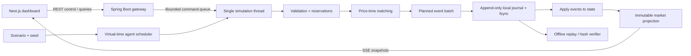

# AI Exchange — đề xuất kiến trúc MVP

Trạng thái: chủ dự án đã duyệt ngày 04/11/2026; chưa triển khai.
Ngày: 19/10/2026.
Nguồn: [nghiên cứu nền tảng và license](../../research/2026-10-19-market-simulators.md).

## 1. Mục tiêu và phạm vi

Xây một market microstructure simulator open-source, dùng để học và thử nghiệm matching engine, hành vi agent và event sourcing. Giá hình thành từ các lệnh khớp thực sự trong mô phỏng. Chạy local miễn phí trên MacBook M2, không cần dữ liệu thị trường, tài khoản cloud hoặc API LLM.

Yêu cầu đã có từ chủ dự án: Java/Spring Boot, hàng trăm trader, Next.js, event sourcing, deterministic replay, public GitHub. Giả định đề xuất: một người vận hành local, một run hoạt động tại một thời điểm, một mã AIX ban đầu, 300 trader mặc định (giới hạn 500), bốn chiến lược. Mở rộng mã và chiến lược sau khi correctness/replay đạt yêu cầu.

Ngoài MVP: ATO/ATC, quy tắc HOSE, margin/short selling, tiền thật, real feeds, multi-user/auth, Kubernetes, Kafka, ClickHouse và LLM chạy theo từng lệnh. Chiến lược có quy tắc và seed là agent mô phỏng; không quảng bá là mô hình học máy nếu chưa có ML.

## 2. Quyết định kiến trúc

Chọn modular monolith cho backend và một frontend. Core Java không phụ thuộc Spring, HTTP hoặc database. Backend bao bọc core bằng REST và SSE. SSE đủ cho luồng quan sát một chiều; lệnh điều khiển dùng REST. WebSocket chỉ thêm khi có nhu cầu giao tiếp hai chiều rõ ràng.



Risk, matching và scheduler là các module được gọi trên cùng simulation thread. Gateway không sửa state trực tiếp. Chỉ tạo batch cho một command tại một thời điểm; cập nhật core sau khi batch được lưu thành công. Thuật toán plan phải không làm biến đổi committed state.

Đề xuất bố cục monorepo:

```text
apps/server/                 Spring Boot adapter, REST/SSE, lifecycle
apps/dashboard/              Next.js App Router + TypeScript
modules/exchange-core/       domain, order book, risk, reducer
modules/simulation/          scheduler, strategies, seeded generator
modules/journal/             file store, event codec, replay
api/openapi.yaml             hợp đồng REST chính thức
scenarios/                   cấu hình tổng hợp có version
docs/                        research, spec, ADR, contribution
.github/workflows/           Java verify, frontend lint/typecheck/build
```

Maven multi-module cho Java; npm và lockfile cho dashboard. Trước khi pin phiên bản Spring Boot/Next.js, kiểm tra release ổn định còn được hỗ trợ và tương thích Java 21/Node 22. Không sử dụng snapshot hoặc latest trong build đã commit.

## 3. Lệnh, book và accounting

Continuous double auction; LIMIT GTC và LIMIT IOC; cancel. Không sửa giá/khối lượng tại chỗ trong MVP: cancel và đặt lại sẽ mất ưu tiên cũ.

- Ưu tiên giá tốt nhất rồi sequence nhận lệnh; FIFO trong cùng mức giá.
- Trade tại giá của resting maker. Một lệnh có thể khớp nhiều mức; IOC hủy phần dư, GTC đưa phần dư vào book.
- Một orderId duy nhất trong run; ID được cấp theo counter xác định.
- Tự khớp: nếu best contra order cùng trader, hủy phần còn lại của incoming order với lý do SELF_TRADE_PREVENTED; không bỏ qua maker để khớp mức sau.
- Cancel kiểm tra owner, symbol và trạng thái. Cancel lệnh đã hoàn tất bị từ chối, không thay đổi tiền/chứng khoán.
- Giá dùng long số tick dương; quantity dùng long số lot dương; quy mô giới hạn để phép nhân không vượt long. Dùng phép tính checked, trả từ chối có lý do khi overflow.
- Một tick bằng 1 đơn vị tiền mô phỏng, một lot bằng 1 cổ phiếu giả lập. Không ngụ ý tương đương bước giá/lô của HOSE.
- Buy reserve limitPrice × remainingQuantity; mỗi trade thanh toán tại makerPrice và giải phóng chênh lệch reserve. Sell reserve lượng cổ phiếu.
- Khởi tạo cash và inventory có sẵn cho mỗi trader; không short, không số dư available âm. Hủy/IOC giải phóng reserve còn lại.
- Phí bằng 0 trong MVP. Tổng cash và tổng inventory mỗi symbol phải được bảo toàn qua trade/cancel; genesis là nguồn cấp ban đầu duy nhất.
- Mọi từ chối nghiệp vụ sau khi vào sequencer được ghi lại. Payload sai định dạng tại HTTP bị trả 400 và không vào domain journal.

## 4. Thời gian mô phỏng và trader

Một scheduler discrete-event, priority queue theo (simTimeNanos, scheduleSequence). scheduleSequence là counter toàn run; agent ban đầu được tạo theo agentId tăng dần. Không dùng thời gian hệ thống để quyết định trading.

Bốn archetype: noise, market maker, momentum và value. Mỗi agent là object trạng thái, không phải thread/process/LLM session. Mỗi agent có PRNG riêng theo thuật toán được version hóa và seed dẫn xuất ổn định từ master seed + numeric agentId; không dựa vào hashCode hoặc iteration của HashMap.

Một run bắt đầu với scenario bao gồm endowment, initial reference/fundamental price, thông số chiến lược, delay và giới hạn số sự kiện. Khi chưa có trade, chiến lược dùng initial reference price thay vì chia cho 0. Thanh khoản ban đầu do market maker đặt; không dùng trade giả để vẽ chart.

Agent đánh thức và gửi lệnh theo simulation time; message latency tối thiểu một quantum để không tạo vòng lặp zero-time. Agent chỉ thấy projection ở thời điểm thông điệp đến, không đọc tương lai. Tốc độ trình chiếu realtime chỉ throttle giữa các bước, không đổi thứ tự. Pause/step chỉ tác động vòng scheduler.

Seed + scenario + cùng engine/strategy/PRNG version + cùng input sequence phải tạo cùng event digest. Lệnh người dùng chen vào thị trường chạy có thể có thứ tự khác giữa các lần chạy; thứ tự thực tế phải được journal lại và replay theo journal.

Giới hạn tài nguyên có cấu hình: tối đa 500 agent, 20.000 lệnh mở toàn run, 100.000 scheduled messages, và 1.000.000 processed simulation events mặc định. Tràn queue/order limit tạo lỗi rõ ràng; không silently drop order. Run dừng an toàn khi đạt ngưỡng. Các con số là guardrail ban đầu, sẽ điều chỉnh sau đo đạc.

## 5. Event sourcing, lưu bền và replay

Một run có manifest: schemaVersion, engineVersion, strategyVersion, PRNG version, scenario canonical hash, seed, runId và giới hạn. Genesis chứa đầy đủ cấu hình và endowment đã chuẩn hóa. runId/thời gian tạo dùng để quản lý; loại khỏi economic-state digest khi so sánh hai run cùng scenario.

Một journal file duy nhất mỗi run là nguồn sự thật. Mỗi record là một command transaction gồm normalized input, commandSequence, simTime, outcome, ordered domain events và checksum. Event có eventSequence liên tục toàn run, schemaVersion và commandSequence nguồn.

Event tối thiểu: RunInitialized, OrderAccepted, OrderRejected, TradeExecuted, OrderRested, OrderCancelled và IncomingRemainderCancelled. Reducer phải quy định rõ mỗi event cập nhật book/reserve/cash/position thế nào để không trừ số dư hai lần.

Quy trình commit:
1. Validate và lập một event batch không đổi committed state.
2. Serialize canonical record, append và force xuống disk.
3. Apply nguyên batch bằng reducer; công bố projection và trả kết quả.
4. Lỗi append/force hoặc reducer: đóng admission, đưa run sang FAILED; không tiếp tục nhận lệnh trên state không chắc chắn. Nếu đã ghi nhưng chưa apply do crash, replay áp lại từ journal.

MVP dùng UTF-8 NDJSON có schema và checksum từng record, một writer, file lock cấm hai process ghi cùng run. Checksum chỉ phát hiện hỏng dữ liệu, không phải chống sửa có chủ đích. Nếu crash để lại record cuối thiếu newline: báo torn tail và yêu cầu thao tác recover tường minh trước khi truncate tail. Checksum sai, sequence gap hoặc lỗi schema ở record hoàn chỉnh: replay thất bại, không tự bỏ qua.

ACK thành công chỉ sau force và apply; đây là bảo đảm ở mức API hệ điều hành, không tuyên bố chống mọi lỗi phần cứng. Journal giới hạn dung lượng có cấu hình (mặc định 256 MiB/run) và dừng trước khi vượt giới hạn. Chưa có retention tự xóa dữ liệu.

Tách hai kiểm chứng:
- **State replay:** tắt agent và external input, đọc domain events, rebuild book/cash/reserve/positions/counters rồi so sánh canonical state hash. Không chạy lại matching khi apply events.
- **Deterministic rerun:** chạy scenario/seed bằng đúng phiên bản engine, so sánh digest của toàn chuỗi domain events và state cuối. Với input từ bên ngoài, dùng normalized commands đã ghi và thứ tự recorded.

Không hỗ trợ resume agent từ giữa run ở MVP; scheduler/PRNG snapshot chưa triển khai. Replay chạy đến command boundary được chỉ định hoặc cuối journal, không tạo lịch sử mới. State hash sắp xếp symbol, agent, order và mức giá/FIFO; không phụ thuộc thứ tự map, wall clock, đường dẫn hoặc UI.

## 6. API contract và dashboard

OpenAPI là nguồn chính; runnable API collection chỉ sinh thêm khi phục vụ kiểm thử, không tạo Postman workspace/cloud không cần thiết.

Đề xuất API /api/v1:
- POST /runs: tạo và khởi tạo run với scenarioId và seed, trả 201 cùng Location. Một active run, tạo thêm trả 409.
- POST /runs/{runId}/advance: chạy số lượng bước hữu hạn, có upper bound; trả 200 sau commit, 409 nếu run sai trạng thái.
- GET /runs/{runId}: trạng thái, counters, simTime và hash ở committed boundary.
- GET /runs/{runId}/book?symbol=AIX&depth=20: snapshot có sequence, depth tối đa 100.
- GET /runs/{runId}/trades?afterSequence=...&limit=...: trang trade theo cursor, limit tối đa 500.
- GET /runs/{runId}/agents?cursor=...&limit=...: danh mục, available/reserved và mark-to-market rõ reference.
- GET /runs/{runId}/events: SSE market snapshots tối đa 5 lần/giây khi có subscriber; client chậm được nhận snapshot mới nhất, không kéo chậm engine.
- POST /runs/{runId}/replay-verifications: chỉ cho run đã dừng, trả kết quả so hash và số record đã đọc; lỗi corruption trả lỗi có cấu trúc.
- GET /actuator/health: health, không thay thế trạng thái run.

SSE id theo projection sequence; reconnect gửi full snapshot. SSE chỉ phục vụ hiển thị, không hứa giao đủ mọi event; audit đầy đủ nằm trong journal. REST query trả immutable projection tại committed sequence.

Các số long về tiền, giá, lượng, time và sequence được encode thành decimal string qua JSON để tránh mất chính xác JavaScript. Seed dùng chuỗi decimal có kiểm tra miền. Error envelope: code, message, details; phân biệt 400 malformed input, 404 unknown run, 409 lifecycle conflict, 422 domain/config validation, 503 resource/journal failure.

Scaffold chưa mở public API hoặc order entry từ Internet. Bind localhost, frontend gọi cùng-origin proxy, giới hạn request size và allowlist origin local. Tạo public source repository không đồng nghĩa triển khai server public. Idempotency cho order submission từ bên ngoài được đặc tả khi thêm order-entry API; các control endpoint hiện tại không tự retry mutation.

Dashboard tối thiểu: run controls (seed, số agent, advance), bid/ask book, recent trades, run counters/hash và bảng agent. Polling dự phòng nếu SSE mất kết nối. Charts/candles và scenario news để milestone sau; không bắt người dùng cấu hình model/API key.

## 7. Chi phí và MacBook M2

Chạy native ARM64: Java 21 + Maven Wrapper, Node.js 22 + npm. Không cần Docker để bắt đầu. File journal nằm trong data/ được gitignore. Đề xuất Java heap tối đa 512 MiB cho profile nhỏ; đây là cấu hình khởi đầu, không phải RSS đo được hoặc bảo đảm tất cả workload.

Profile mặc định: 300 agent, một symbol, 10.000 simulation events cho quick demo. Profile kiểm tra quy mô: 500 agent, 100.000 events. Không đặt cam kết latency/throughput trước khi benchmark full path có journaling.

Chi phí dịch vụ runtime = 0 khi chỉ chạy local bằng chiến lược có quy tắc. Dependency install và GitHub cần Internet; RAM/SSD/điện vẫn do máy sử dụng. GitHub Actions cho repository public cần kiểm tra hạn mức hiện hành trước khi bật job tốn tài nguyên; không yêu cầu billing hoặc dịch vụ trả phí.

## 8. Tiêu chí hoàn thành

Scaffold đầu tiên phải có:
1. Maven Wrapper, module boundaries và Spring health có thể build/test với Java 21.
2. Next.js + TypeScript với lockfile, trang trạng thái tối thiểu và lệnh lint/typecheck/build chạy được.
3. OpenAPI parse được, README quickstart, Apache-2.0, CONTRIBUTING, SECURITY và provenance policy.
4. CI checks tương ứng và repository public DTN104/ai-exchange sau khi chủ dự án duyệt.
5. Nếu scaffold kèm thin vertical slice, phải có test matching FIFO/partial/IOC/cancel, risk reserve, conservation và journal/replay. Không ghi README như thể toàn MVP đã xong nếu chỉ có module khung.

MVP đầy đủ đạt khi:
- Demo 300 agent hoạt động trên giá do matching tạo ra, có ít nhất một trade.
- 500-agent profile hoàn thành trong ngân sách tài nguyên đo trên M2; ghi thông số máy, thời gian, RSS và journal size.
- Cùng scenario/seed chạy hai lần có cùng event digest và economic-state hash.
- Replay file đã đóng cho cùng book, balances, reserves, positions và counters.
- Test maker price, FIFO nhiều lệnh cùng giá, partial fill, IOC dư, cancel owner, thiếu tiền/cổ phiếu, duplicate order, overflow, self-trade và giới hạn queue.
- Crash-tail, checksum mismatch, sequence gap, journal failure và restart/replay có kiểm thử.
- Có kiểm thử luồng dashboard/API thực và báo rõ phần nào chỉ là mock.
- Tài liệu phân biệt state replay, deterministic rerun và resume chưa hỗ trợ.

## 9. Trình tự milestone đề xuất

A. Repository và scaffold build được, contract và contribution docs.
B. Matching + accounting + invariant tests.
C. Event journal + replay verifier + failure tests.
D. Scheduler + bốn chiến lược + deterministic rerun.
E. Dashboard kết nối thực, đo profile M2 và demo được ghi lại.

Chưa chốt kế hoạch thực thi chi tiết trong tài liệu này. Sau khi chủ dự án duyệt spec, viết implementation plan theo milestone và chọn cách thực thi.
